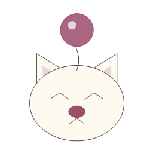

<p align="center">
  
</p>

<h1 align="center">Kupo Skribbl</h1>

<p align="center">A little drawing. A little guessing. A lot of questionable art.<br />A multiplayer drawing and guessing game, right inside Final Fantasy XIV.</p>

<p align="center">
  <a href="https://github.com/cloudesh/kupopop/releases"></a>
  <a href="https://github.com/cloudesh/kupopop/releases"></a>
  <a href="https://github.com/cloudesh/kupopop/issues"></a>
</p>

## Install & play

In Dalamud, open **Settings → Experimental → Custom Plugin Repositories**. Paste the link below, save, then find **Kupo Skribbl** in the plugin installer.

```text
https://raw.githubusercontent.com/cloudesh/kupopop/main/plugin/releases/repo.json
```

**Open the game with `/kupopop` or `/kuposkribbl`.** Everyone connects automatically—create your profile and you're ready to play.

This is an experimental plugin distributed through a custom repository. It is not currently listed in the official Dalamud repository.

## How to play

1. **Find your group.** Join a friend with a room code, host a room, or browse public lobbies. Bring up to 16 players.
2. **Pick and draw.** When it's your turn, choose a word and bring it to life on the canvas. Artistic talent is entirely optional.
3. **Guess in chat.** When someone else draws, type your guesses into the room chat. Solve earlier to earn more points; drawers earn points when others get it right.
4. **Celebrate the winner.** Everyone takes a turn each round. The player with the most points at the end wins!

## Make it your own

- Choose from FFXIV, everyday things, internet memes, and video games.
- Set your room's timer, rounds, and word lists.
- Draw your own profile picture or choose a moogle face or job emblem.
- Use pencils, shapes, fill, a colour palette, and undo to rescue your masterpiece.
- Pick light or dark paper to suit your setup.

Save your private recovery code when you create your profile. Keep it somewhere safe and don't share it.

## Something gone wonky?

[Report a bug or suggest an idea](https://github.com/cloudesh/kupopop/issues). For bugs, tell us what happened and what you expected. Please leave passwords and recovery codes out of reports.

Download badges count release-asset downloads, including repeat downloads and older releases; they aren't a player count.

Not affiliated with Square Enix or skribbl.io.